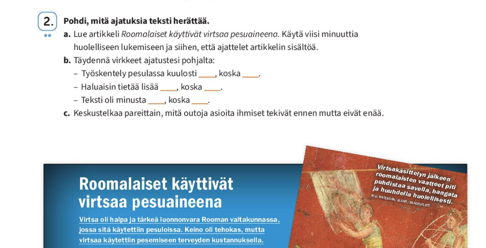

Когда семья переезжает в Финляндию, одной из главных задач становится интеграция ребенка в местную систему образования. Первое время родители радуются: в финских школах нет привычного стресса, оценок в первые годы учебы и огромных домашних заданий. 

Однако через полгода может выясниться, что ребенок ушел в себя, почти не общается с одноклассниками и молчит, когда учитель вызывает его к доске. При этом дома он может уверять, что «всё нормально».

Давайте разберем причины этого защитного барьера и конкретные шаги, которые помогут ребенку его преодолеть без потери самооценки.

---

### ❌ Проблема: Страх совершить ошибку (Синдром отличника)

В русскоязычной культуре образования ошибка часто воспринимается как провал. Подросток боится перепутать падеж или окончание глагола, поэтому выбирает стратегию «лучше промолчать, чем показаться смешным». В итоге он теряет необходимую речевую практику.

### ✅ Как помочь: Перевод фокуса с оценки на коммуникацию

Объясните ребенку базовое правило финского менталитета: финны очень терпимы к ошибкам иностранцев, для них важен сам смысл сообщения, а не идеальная грамматика.  Иногда небольшая доля здорового пофигизма здорово помогает в общении :) Главное, чтобы тебя поняли.

* **Показывайте личный пример:** Если вы сами учите финский и ошиблись в магазине или на курсах, расскажите об этом ребенку с улыбкой: *«Я сегодня перепутал слова, но меня всё равно поняли»*.
* **Проверяйте слова вместе:** Если возник спорный момент, загляните вместе в Википедию или Kielitoimiston sanakirja или предложите ребенку уточнить фразу у школьного учителя.
* **Выучите дома фразы**, которые помогут не впадать в ступор на уроке: 
  -  *«Voisitko toistaa, kiitos?»* (Не могли бы вы повторить, пожалуйста?)
  - *«Voisitko selittää tämän toisin?»* (Не могли бы вы объяснить это другими словами?)
  - *«Hetkinen, mietin vähän...»* (Минуточку, я немного подумаю...)
  - *«Hyvä kysymys, hetkinen...»* (Хороший вопрос, секундочку...)
  - *«En ole vielä varma, mutta mielestäni...»* (Я пока не уверен, но по-моему...)
* **Хвалите за смелость:** Отмечайте любую попытку высказать мысль на финском, даже если в ней были грамматические неточности.

---

### ❌ Проблема: Разница в культуре общения

Финские дети с детства привыкли к соблюдению личных границ и тишине. Они редко проявляют инициативу в знакомстве первыми. Наш подросток может принять это за холодность или нежелание общаться, чувствуя себя отвергнутым.

### ✅ Как помочь: Интеграция через общие интересы

В Финляндии дружба и общение строятся вокруг совместной деятельности.

* **Найдите секцию по интересам**: бассейн, кружок рисования или клуб робототехники. 
* В неформальной обстановке, где фокус смещен на игру или хобби, языковой барьер падает быстрее. 

---

### ❌ Проблема: Отсутствие навыка аргументации

Финская школа практически не требует механического зазубривания параграфов. На уроках истории или обществознания (*yhteiskuntaoppi*) от ученика постоянно ждут личной позиции.

📸 Взгляните на задание из финского учебника для 7 класса:

После небольшого текста ученику предлагают:
* *«Pohdi, mitä ajatuksia teksti herättää»* — подумать, какие мысли вызывает прочитанное.
* Закончить фразы со словом *koska* (потому что), самостоятельно обосновав свое впечатление (*«Työskentely pesulassa kuulosti _____, koska _____.»*).
* Обсудить тему в паре с одноклассником (*«Keskustelkaa pareittain...»*).

В учебнике готового «правильного» ответа нет, и подросток, непривычный к такому формату, теряется и молчит.

### ✅ Как помочь: Тренировка аргументации на родном языке

Этот навык нужно сначала сформировать в комфортной домашней среде.

* **Обсуждайте повседневные темы:** Во время ужина или прогулки чаще задавайте ребенку открытые вопросы: *«Почему герой фильма так поступил?»*, *«Как бы ты решил эту ситуацию?»*.
* **Научите формуле «Тезис + 2 аргумента»**: Попросите ребенка не просто сказать «мне понравилось» или «это несправедливо», а привести две-три причины на русском языке. Потом эту логику ему будет проще перенести на финский язык и использовать в классе.
