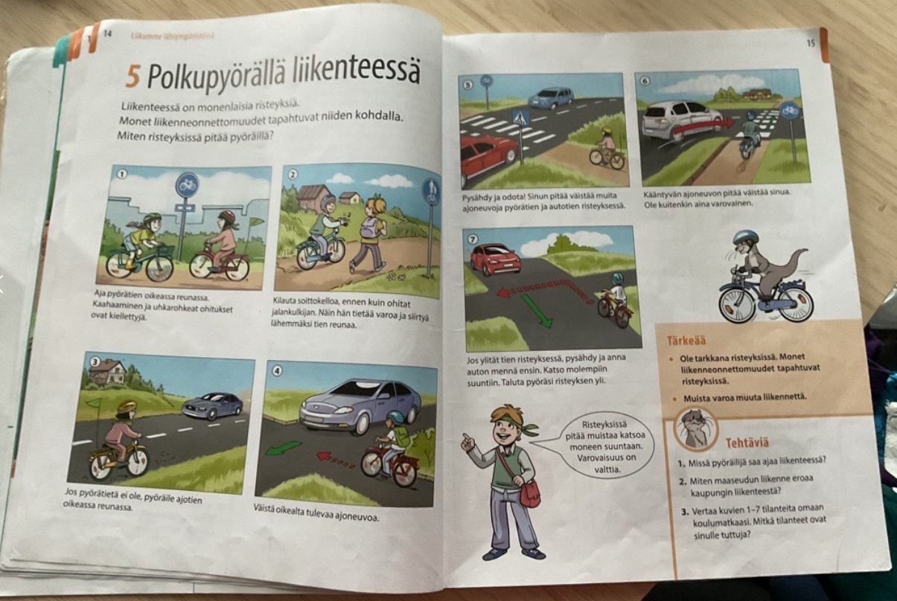

Когда русскоязычный подросток переходит в финскую школу или колледж, родителям часто кажется: «Раз он уже неплохо болтает со сверстниками на переменах, значит, с учебой проблем не будет».

Но через пару месяцев успеваемость падает, ребенок закрывается, часами сидит над учебниками и испытывает жесткий стресс. Почему современные учебные программы (Huima Oma-harjoituskirja или Sanasankari S2 или профильные школьные материалы по предметам) часто становятся ловушкой для ребят?

Давайте разберем три частые проблемы, с которыми сталкивается учащийся, и конкретные варианты их самостоятельного решения дома.

### ❌ Проблема: Бытовой финский против академического

Современные учебники прекрасно развивают «живой», разговорный язык. Подросток быстро учится общаться с друзьями. “Mää tuun sit ku kerkeen”.
Но когда открываются предметные учебники издательств Sanoma Pro или Otava (например, серии Koodi или Kasvu по биологии, Memo по истории), начинается академический язык (yleiskieli) со сложными терминами и пассивными конструкциями. Ребенок может отлично знать бытовое слово syödä (есть), но теряется перед терминами ravinto (питание) или yhteyttäminen (фотосинтез). Он понимает отдельные простые слова, но из-за пассивных оборотов вроде on havaittu (было замечено) не может уловить общий смысл параграфа и отстает по предмету.

📸 Взгляните на типичный разворот финского школьного учебника. 

Тема кажется максимально простой — «5. Polkupyörällä liikenteessä» (На велосипеде в дорожном движении). Казалось бы, ребенок каждый день катается во дворе и умеет общаться на эту тему.
Но посмотрите, с каким терминами он сталкивается на этой странице:
* risteys (перекресток), ajoneuvo (транспортное средство).
* Инструкции требуют знания глаголов: väistää (уступать дорогу / избегать столкновения) и ohittaa (обгонять).
* Встречаются специфические слова, которые не используют в обычной беседе на детской площадке: taluttaa (вести велосипед рядом с собой пешком) или uhkarohkea (безрассудный/отчаянный).
Если подросток не владеет этой базой, он не сможет правильно ответить на вопросы в конце параграфа (блок Tehtäviä), даже если в жизни он прекрасно ездит на велосипеде.

### ✅ Вариант решения: Метод «Двуязычного глоссария»

Не заставляйте ребенка переводить большие тексты целиком — это быстро вызовет отвращение к учебе.
* Перед чтением текста откройте параграф и выпишите на листок только термины (как в нашем примере: risteys, väistää, taluttaa).
* Переведите их на русский язык вместе с ребенком, учитывая контекст.
* Когда у подростка перед глазами будет «карта терминов» на родном языке, его мозг свяжет финский академический текст с логикой предмета. Чтение и понимание текста пойдут значительно быстрее.

---
### ❌ Проблема: Иллюзия простоты в грамматике

Финская методика (например, в учебниках родного языка серии Särmä или Huima) построена на интуитивном восприятии: «повторяй за носителем, со временем наслушаешься и поймешь». Грамматика часто дается поверхностно. 
Без понимания логики системы (почему слово меняется именно так при чередовании согласных k-p-t) подросток начинает механически зазубривать формы. Пытаясь сказать «я сплю» от глагола nukkua, он интуитивно подставляет личное окончание и получает несуществующее nukkun. Не понимая, почему правильная форма — nukun и куда исчезла буква «k», ребенок замыкается, путается и "глотает" окончания. Возникает ступор и страх ошибиться при устном ответе в классе.

### ✅ Вариант решения: Составление схемы слова

**Покажите ребенку, что финская грамматика — это не хаос, а математика.**
* Нарисуйте схему слова, научите делить слова на слоги (я столкнулся с тем, что подросток в 8 классе не смог правильно разделить слово на слоги). 
* Выписывайте основы глаголов и существительных на отдельные карточки (например: *lukea -> основы: luke- /lue-*). 
* Когда подросток поймет, что язык — это конструктор, где к правильной основе просто прибавляется окончание, у него исчезнет страх перед сложными грамматическими формами.
---

### ❌ Проблема: Иллюзия контекста при работе с онлайн-переводчиком

Финская система требует от ученика высокой самостоятельности — нужно самому догадаться о значении слова из контекста, а на уроках обществознания (учебники Forum или Uniikki) часто просят выразить свое мнение. 
Подросток, сталкиваясь со сложной формулировкой, открывает переводчик в телефоне.
Но онлайн-переводчики переводят финские идиомы буквально, полностью искажая смысл задания. Подросток пишет в гугл-переводчике "vetää lonkkaa" и получает дословный перевод "тянуть тазобедренный сустав" вместо правильного "бить баклуши". Ребенок делает уроки часами и получает плохую оценку из-за того, что не понял сути вопроса.

### ✅ Вариант решения: Проверка через обратный перевод

**Этот метод позволяет родителю контролировать качество уроков, даже если сам родитель не знает финского языка.**

* Когда ребенок выполнил задание в учебнике (например, заполнил пропуски в тексте или ответил на вопрос), попросите его вслух перевести то, что он написал, на русский язык.
* Если получившийся русский перевод звучит коряво или абсолютно абсурдно — значит, проблема была на этапе понимания задания. Это позволит вовремя найти и исправить ошибку до того, как результат работы попадет на проверку к учителю.
